# Atlas of Svellheim

The [map of Svellheim](../maps/svellheim-painted-atlas.png) follows the coast, the mountains of the interior and the northern ice. Before Fimbulwinter, river traffic joined the inland farms to the southern ports.

## Coastal Belt

### The Splintered Fjords

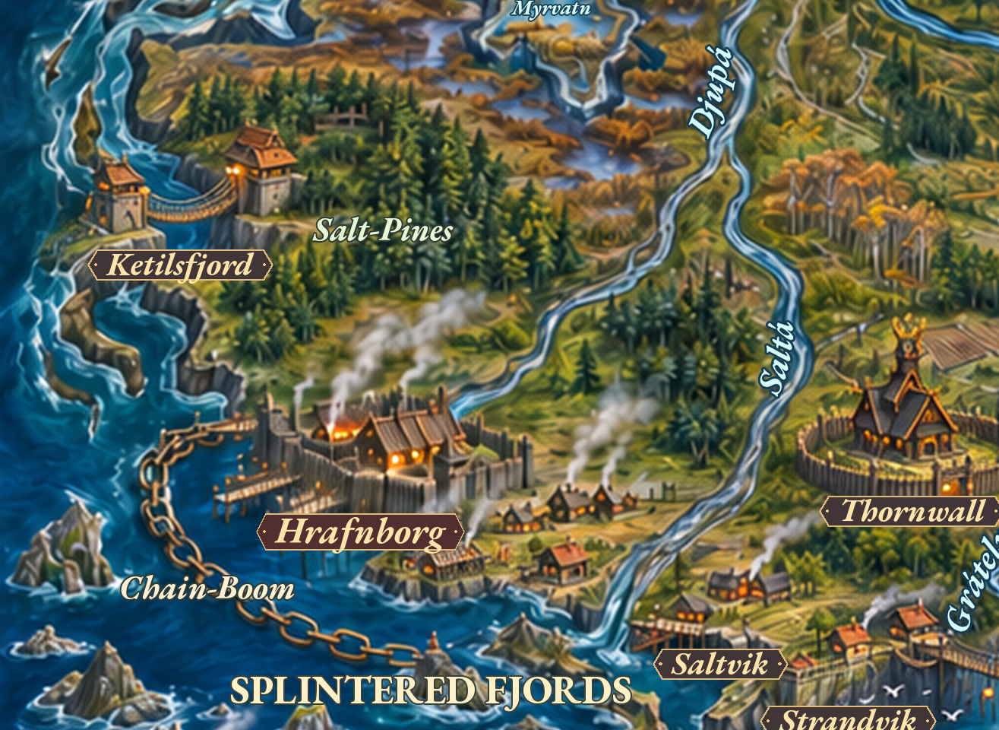

Deep inlets cut the southwestern shore into sheltered fishing grounds. Many villages on opposite shores are closer by boat than by road. At **Ketilsfjord** a chain bridge spans the inlet and its guards collect a toll. **Hrafnborg**, largest of the surviving cities, grew around a natural flame above its harbor. The **Chain-Boom** can close that harbor to ships. Brine-soaked timber from the neighboring **Salt-Pines** burns blue.

**Saltvik**, at the mouth of the Saltá, cures herring and holds its public assembly aboard a beached longship. Farther east, **Thornwall** musters the coastal defenses at a timber temple to Thunar, god of protection. The hills inland sheltered the earliest Veilfolk burrow-halls.

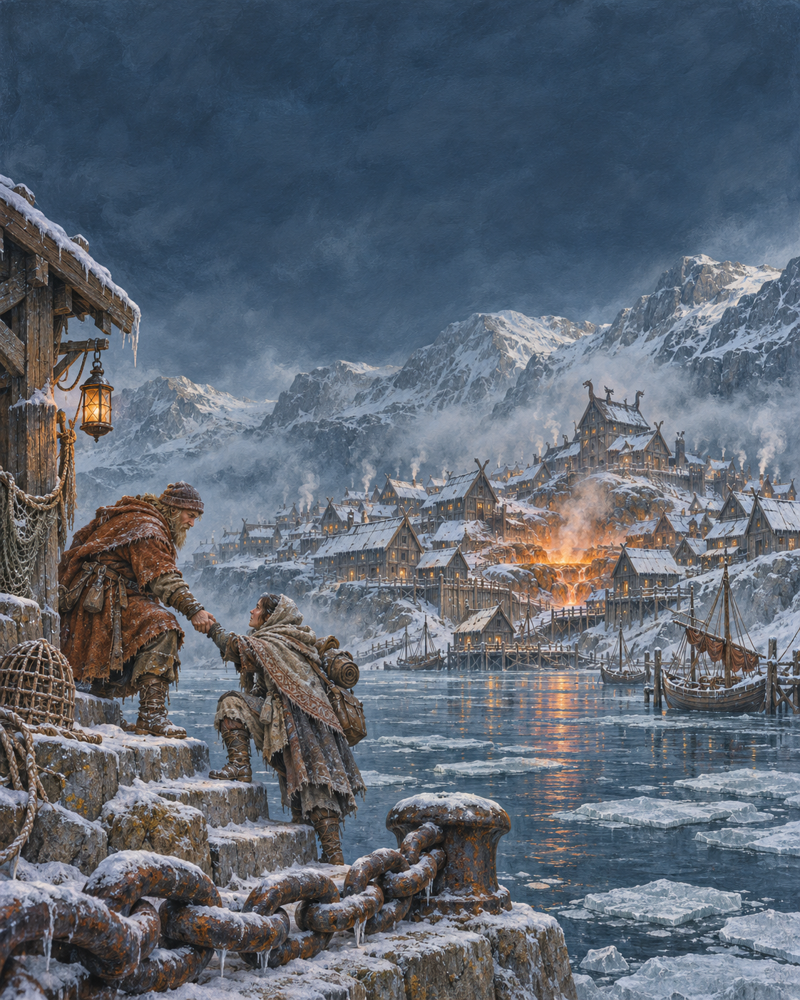

### The Weeping Coast

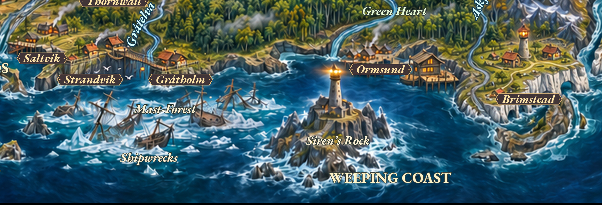

Once Svellheim’s gateway to the southern trading ports, the Weeping Coast now depends on salvage. The **Mast-Forest** is the bay off **Grátholm** where shipwrecks stand close enough to pass between them at low tide. Salvagers bring timber, cargo and iron fittings to the old customs house. The weavers of **Brimstead** maintain the lighthouse on the chalk cliffs and record the names of drowned sailors in its tapestry.

West of Grátholm, rope bridges give the people of **Strandvik** access to the seabird colonies. Their cliff shrine honors Njoror, god of the sea. The lighthouse on **Siren’s Rock** still burns although no keeper has been seen for years. **Ormsund**, at the mouth of the Ormá, once shipped most of the inland grain. Boats still use the lower river when the ice allows.

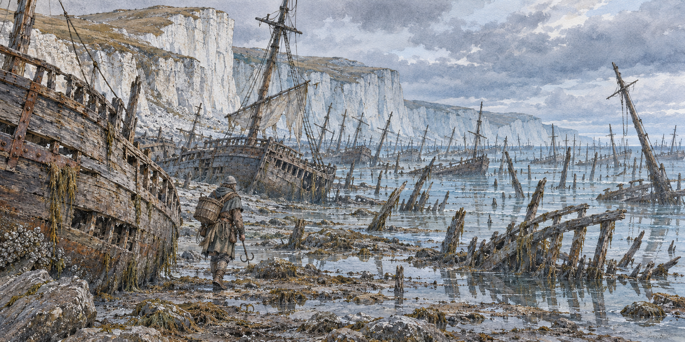

### The Singing Islands

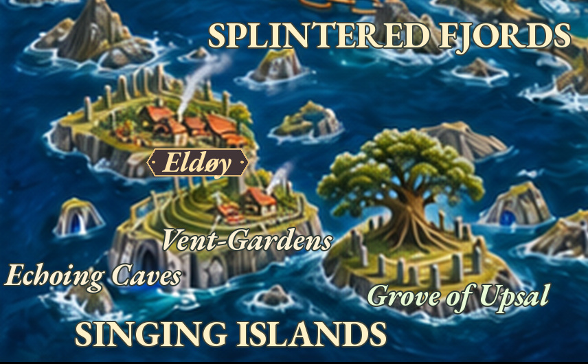

Wind sounding through arches of volcanic rock gives the western islands their name. The **Echoing Caves** carry a voice for great distances. Skalds, the singers who preserve news and history, have used them to reach listeners beyond the ordinary range of a shout.

On **Eldøy**, the largest island, the assembly meets in a natural hollow with similarly clear acoustics. Volcanic heat warms the soil of the **Vent-Gardens**, where farmers still grow vegetables on terraces above the sea. Southeast of Eldøy the old yews of the **Grove of Upsal** remain sacred. The islands preserve living woodland and fresh crops that have largely disappeared from the mainland.

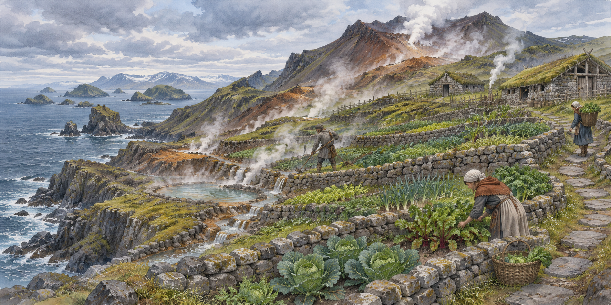

## Interior Belt

### Midgard’s Shield

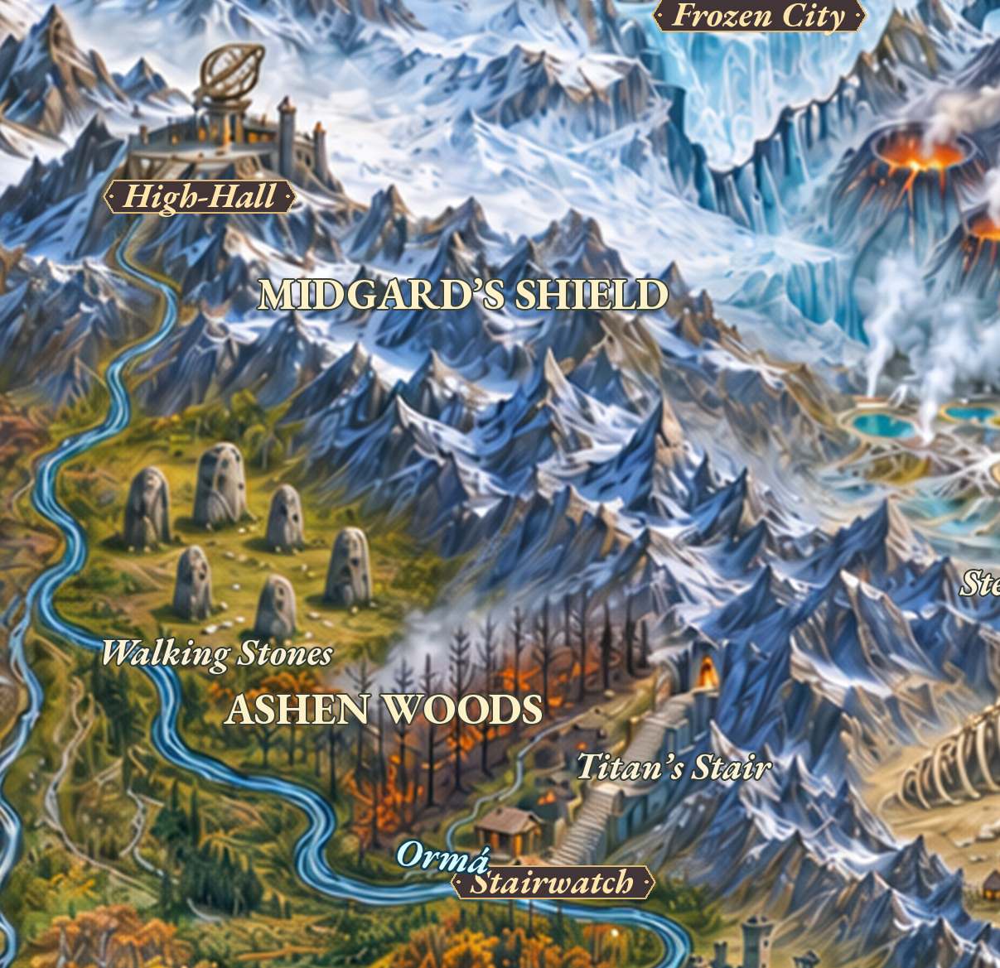

This central mountain range divides the watersheds and concentrates travel into a handful of passes. At **Titan’s Stair**, giant-cut steps connect the western approach with the high eastern plateau. Control of the pass and its underlying galleries determined the final battle of the Second War. **Stairwatch**, immediately west, maintains stone shelters for travelers.

High above the headwaters of the Ormá stands **High-Hall**, a sealed observatory built by Deepforged scholars after their people began to settle above ground. The Cragbound established villages on the high grazing shelves. Their guides and the builders of the deep holds kept open the roads between coast and plateau.

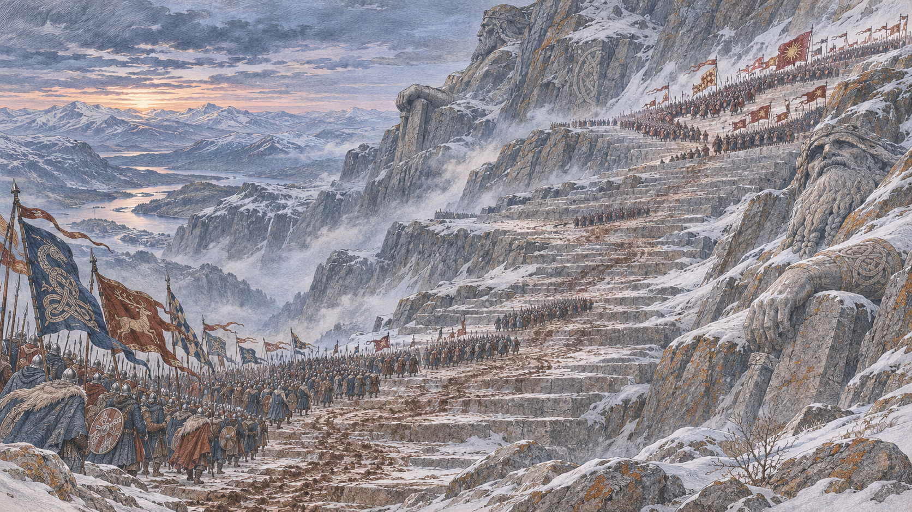

### The Iron Bogs

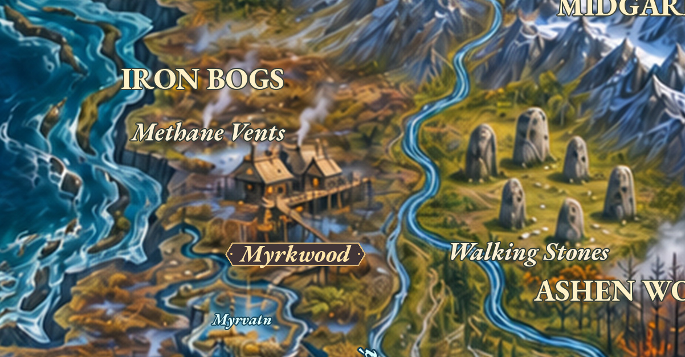

The wetland around **Myrvatn** yields workable iron and preserves the bodies buried in its peat. **Myrkwood** stands on piles above the soft ground. Its smiths process the local ore while its fishers work patches of open water on the iron-red lake.

Gas escaping through the **Methane Vents** interrupts the ice and sometimes catches fire. The standing pillars known as the **Walking Stones** are unreliable landmarks. Local accounts hold that they change position at the new moon.

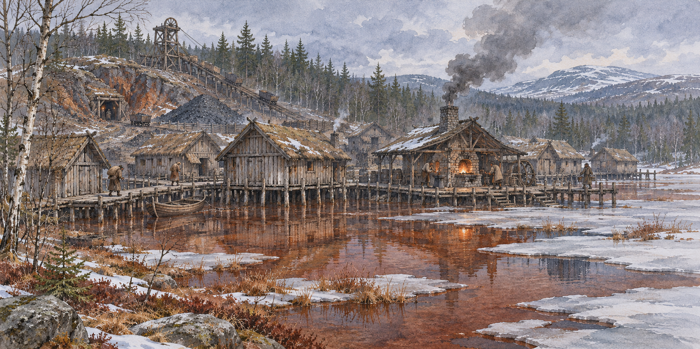

### The Ashen Woods

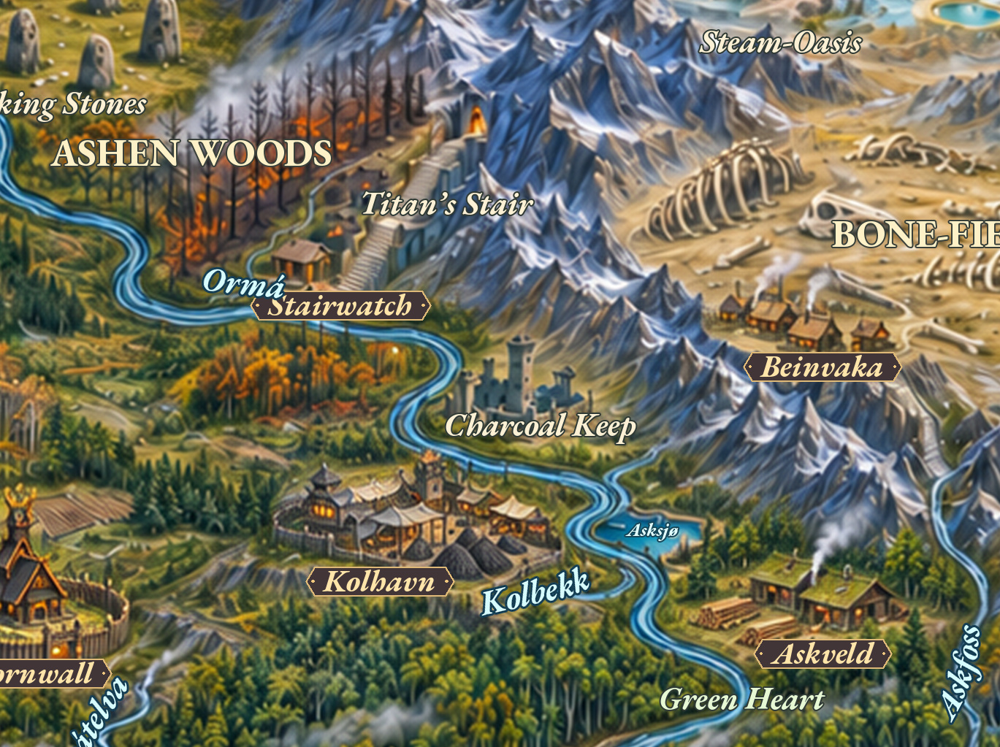

The forest along the Askfoss was once the Greenweald. Fuel raids in the War of Fire burned much of its canopy. Ash and fallen trees still clog the channels that once carried woodland produce to the coast. **Charcoal Keep** is a fort of blackened timber. At **Kolhavn**, beside the silted reservoir of **Asksjø**, families known as the Ashwright Kins set the price of charcoal for the downstream towns. The settlement filters its drinking water at the reservoir outlet.

**Askveld** stands on a surviving woodland margin. Local accounts place the **Green Heart**, a grove guarded by spirits of the trees, near the eastern edge of the burned country. Its survival remains a matter of report.

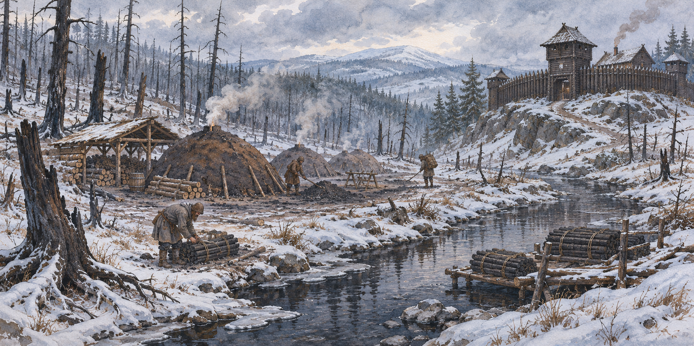

### The Frozen Steppe

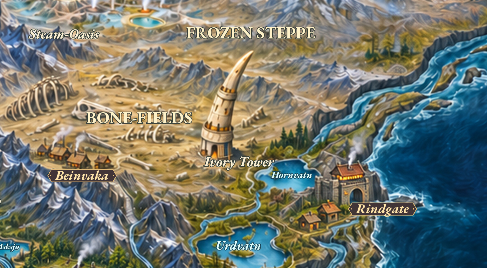

The **Frozen Steppe** occupies the elevated plateau east of the Shield. Within it lie the **Bone-Fields**, where the ribs of immense ancient beasts rise above the snow alongside the remains of giants who fought in the First War. **Beinvaka** is a gathering ground for mobile households and the carvers of pale ghost-ivory. At the new moon the Firekeepers light signal fires on cairns to guide families to the gathering. The **Ivory Tower** was carved from a single great tusk.

On the eastern approach to the passes, **Rindgate** collects its toll in food or iron. A short river runs from **Hornvatn** through the town to the sea. Ruined farmsteads mark the former lakeshore settlements.

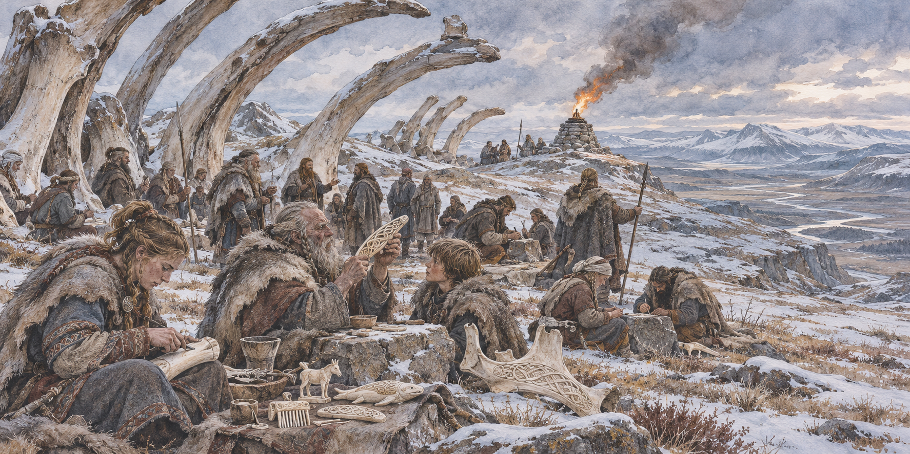

### The inland waters

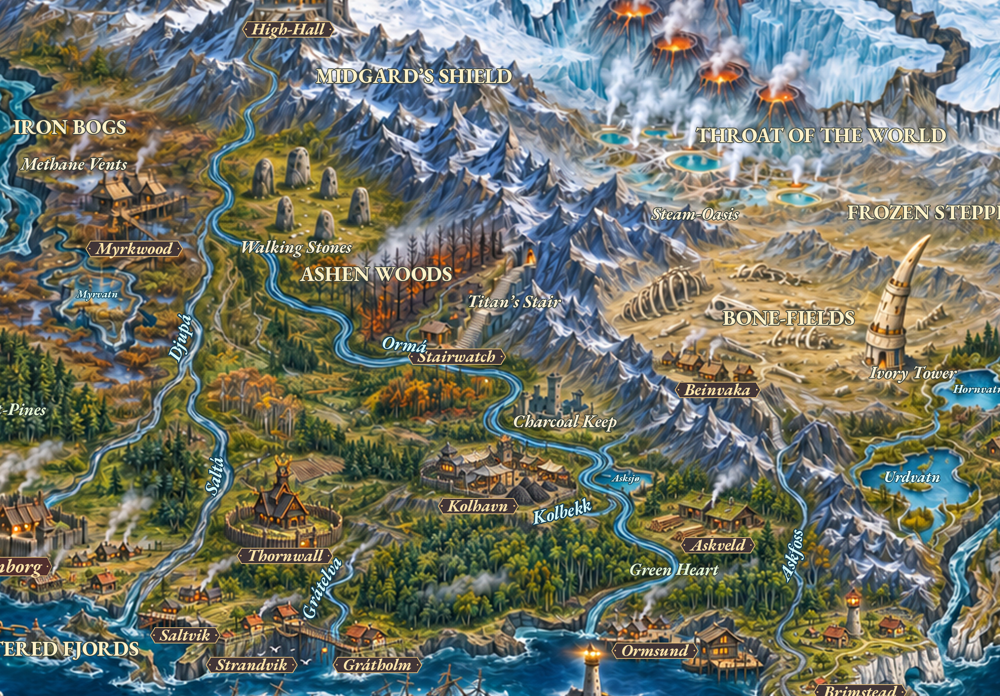

The **Ormá** rises below High-Hall and divides into the Ormá and the **Djupá**. The main Ormá flows southeast through the former grain country to Ormsund. The **Kolbekk** brings water and charcoal bundles down from Kolhavn. Ormsbani oath-halls once guarded the shallow crossings of the upper river.

The Djupá flows west through the bog country before dividing again. Its main channel leads toward Hrafnborg. Its eastern branch, the **Saltá**, reaches Saltvik. The **Grátelva** has its own source in the mountains below the Ashen Woods and reaches the sea near Grátholm. The spring-fed **Askfoss** runs through the former Greenweald to the coast west of Brimstead.

**Urdvatn** lies at the foot of the Shield. A ruined ring fortress marks its eastern shore. Nearby Reedbank gave the Barrowbound shelter, a decision that drew the kingdoms into the [War of the Dead](03-history.md#the-quarrel-at-urdvatn).

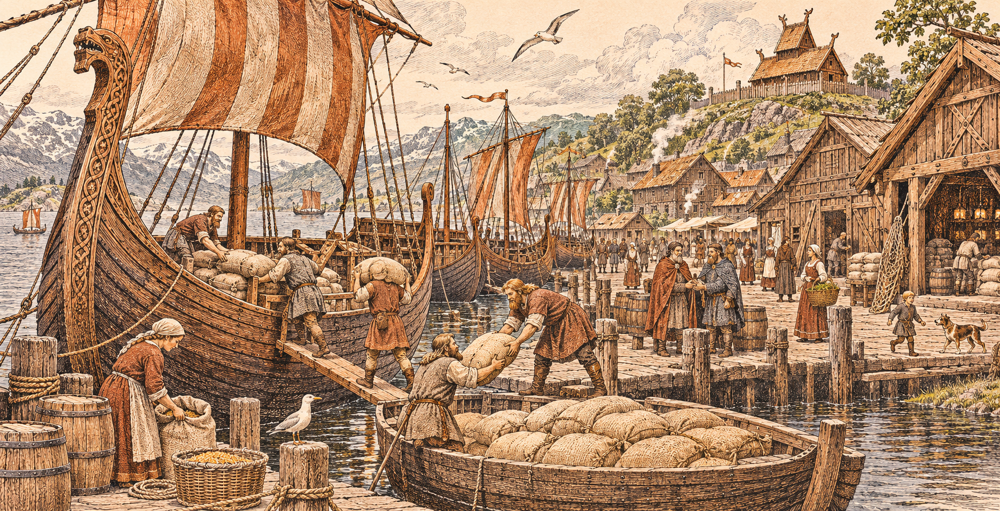

## Northern Belt

### The White Waste

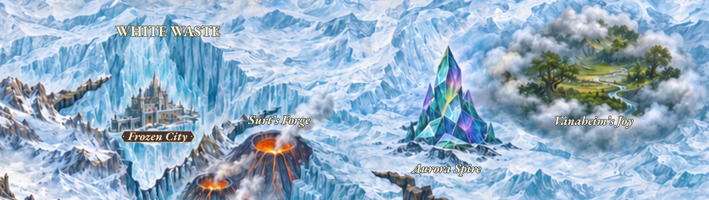

The northern glacier ends in a sheer wall. The towers and roofs of the **Frozen City** are visible through the ice. Its people and fate remain unidentified. Farther east a crystal peak, the **Aurora Spire**, catches the northern lights. Lumenkin tradition identifies the light in the crystal as the star their ancestors followed into this world. Their early coastal settlements lay southeast of the Spire. Magic near the peak is unpredictable.

Maps mark **Vanaheim’s Joy** with a cloud. Travelers describe a hidden valley where summer survives. Its name recalls the green realm of the Vanir gods, and its location remains uncertain.

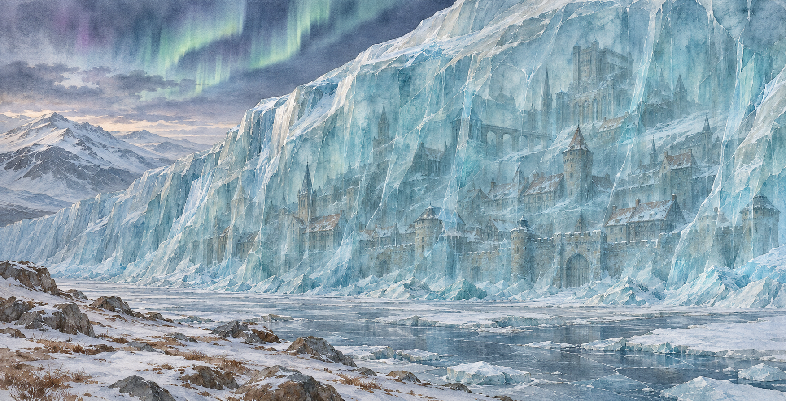

### The Throat of the World

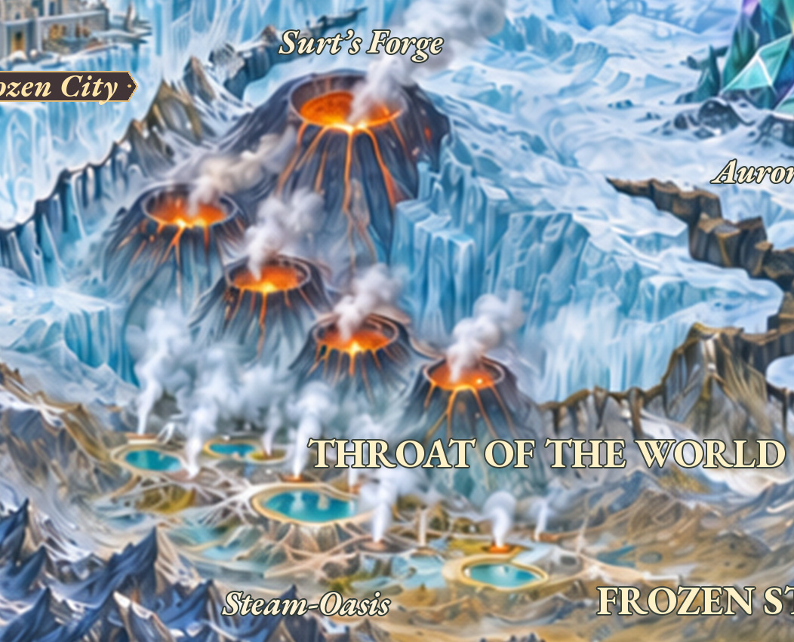

The volcanic ridges beyond the ice throw warm ash over the surrounding snow. **Surt’s Forge**, the largest crater, takes its name from the giant who rules the realm of fire. Northern tradition places the forges of fire giants below its rim.

Hot water drains into the **Steam-Oasis**, a valley of bathing pools and cultivated terraces. The earliest Cinderbound villages lay to the south within reach of the outflow. Their communities protected the peace of the pools, extending the same right to bathe to enemies and allies. Warm workrooms, gardens and pottery kilns sustained trade with settlements farther south.

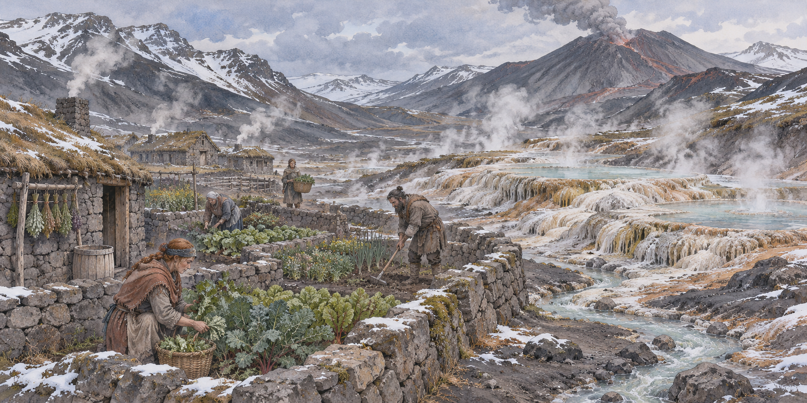
