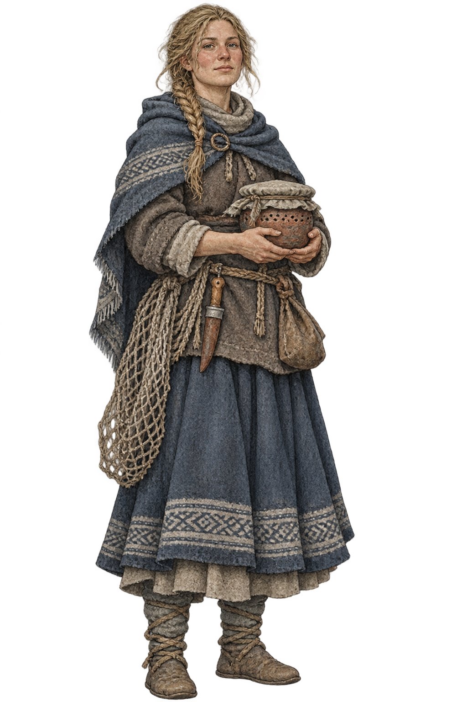
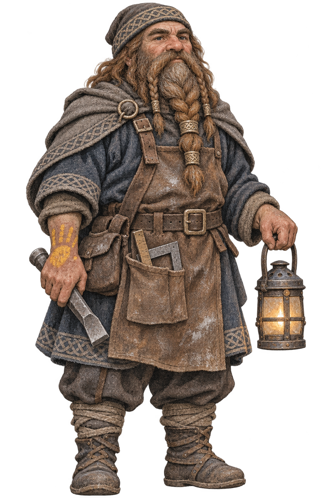
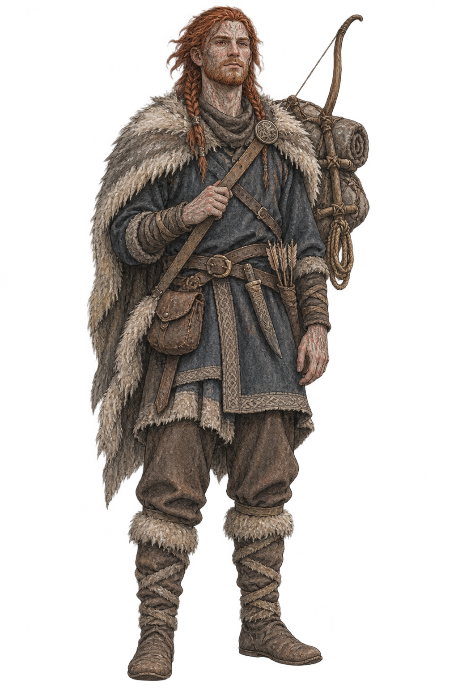
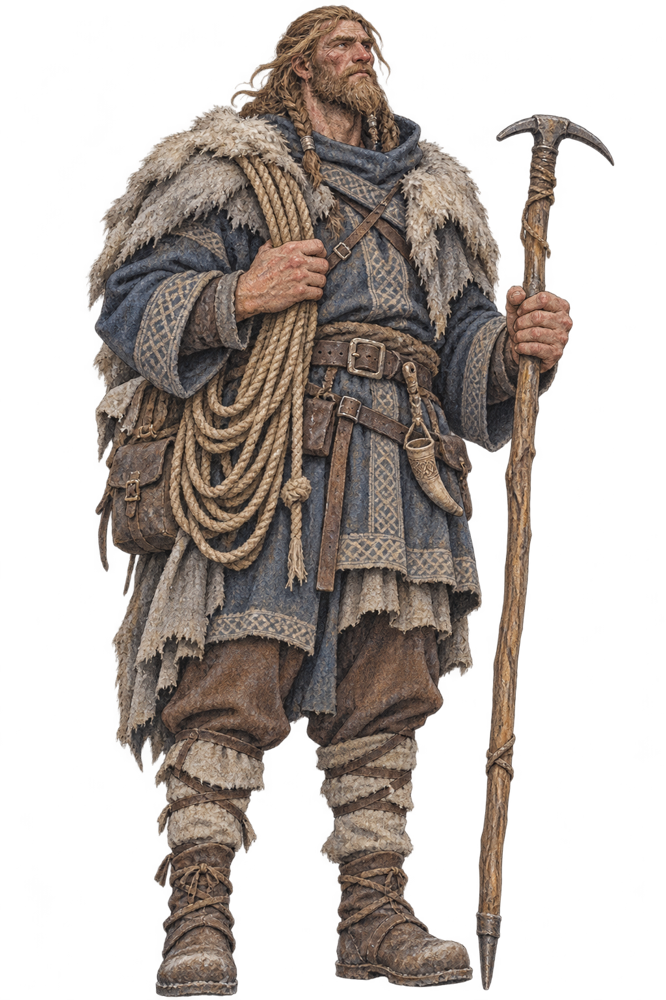
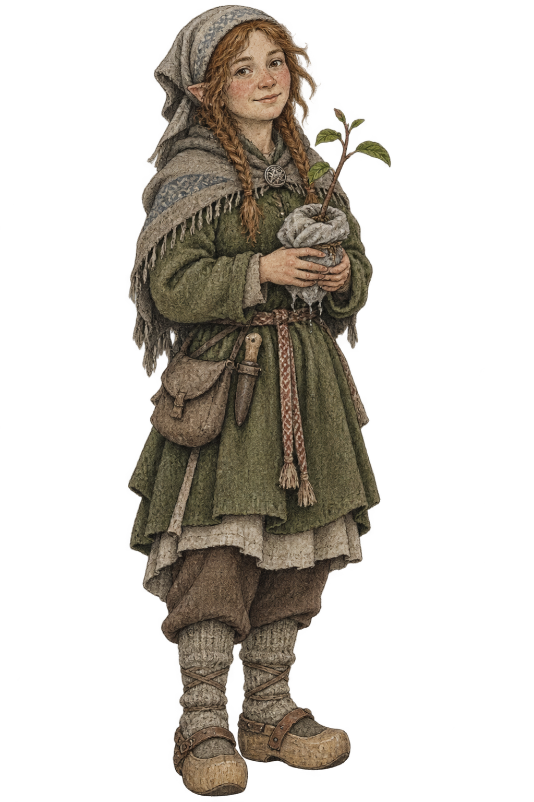
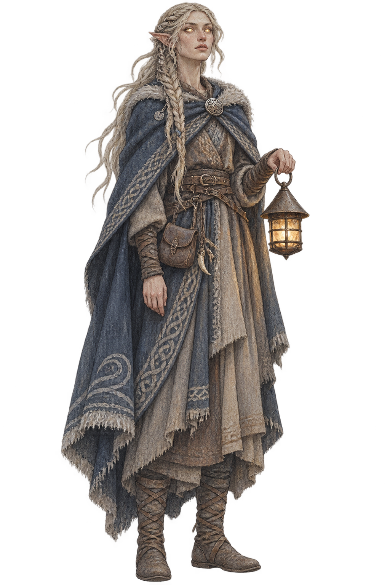
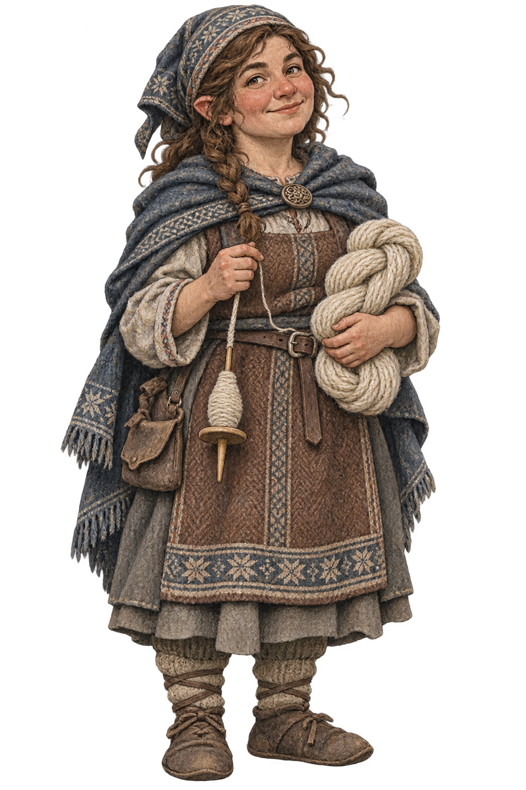
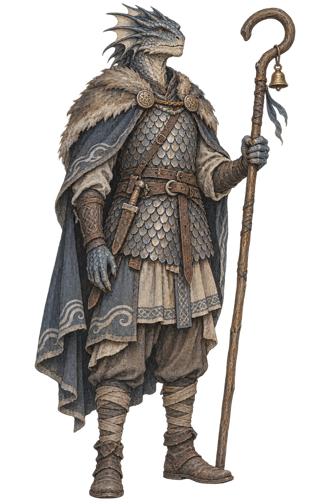
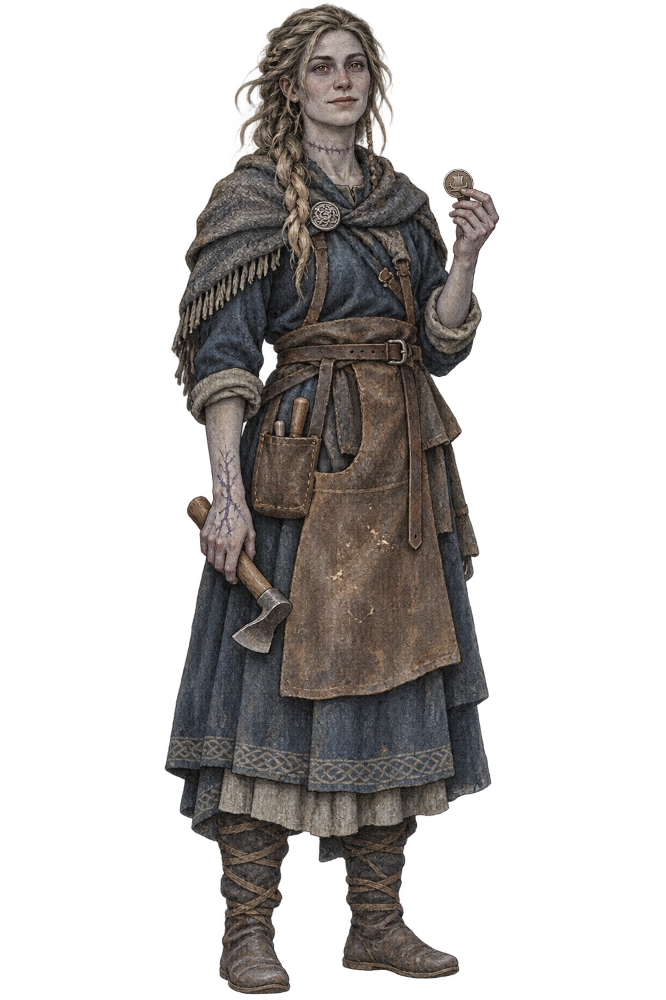
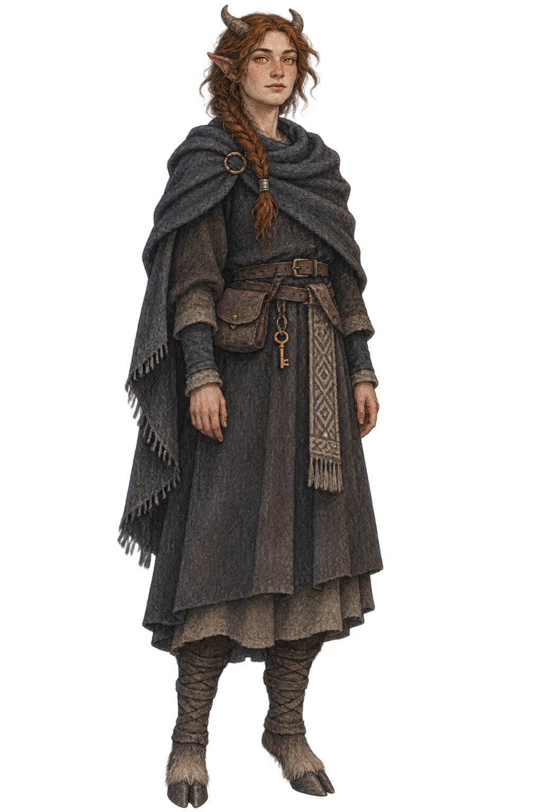

# The Peoples of Svellheim

## The Beginnings of the Peoples

The oldest name in the songs of Svellheim belongs to Ymir. In the gulf between the ice of Niflheim and the fires of Muspelheim, rime gathered and dripped, and in the drops there was life. Ymir stood up in the mist. His children, the giants called Jötnar, could already speak his name when three gods came upon him. Their names were Grimnir, Vili and Vé. Together they killed him. The brothers made Midgard, the realm of mortals, out of his body. His blood filled the seas. The ridges that cross Svellheim from west to east were once his bones. So a skald at a king's table can sing of the making of the land, and a giant listening at the same table can hear the manner of his grandfather's death.

Scarcely a written word survives from the years before Yggdrasil took root. The great tree now reaches between worlds. Children learned their beginnings by listening to the people who raised them. What they heard depended in part on where they sat down to supper. The giants' kin can name the woman who bore them into the heights. On the eastern coast there are singers who can point to the very star under which their people lived before ever they saw the sea of Midgard. Which came first, the lighting of a fire in the fjords or the passing of that star from its place, no song can settle.

## Hearthborn

### The inner fjords

The sheltered inlets between Ketilsfjord and the mouth of the Saltá are the oldest human homelands in Svellheim. Fresh streams, shingle beaches and narrow shelves of barley land supported villages of turf-roofed houses. Boat sheds stood on the beach and grain stores uphill beyond the tide. Households shared landing rights and held assemblies in a common hall. Hrafnborg grew from one such settlement around a natural flame spring.

### Faith and custom

Each winter a child carries a covered pot of coals to a neighboring house in memory of Frigg, who entrusted her fire to the first child of the fjords. Over supper the households agree on food and lodging for the season. This duty extends beyond kin. A stranger coming off the ice may claim a place to thaw before the host decides how much more the household can spare.

### The Hearthborn of the Fjord Clay

Frigg, the goddess who keeps the household hearth, was crossing the narrow sea inlets of the Splintered Fjords in a winter when the sea froze to the mouths of the streams. She carried her fire in a clay pot, the way a family moving house might carry enough live coals to light the next hearth. At the mouth of the Saltá she stopped to tie her shoe and felt a breath of warm air against her bare wrist. Beneath the bank a child lay folded in the blue clay. Frigg dug the child free and held her beside the pot until she cried. Then from all along the bank came an answering clamor. Frigg had only two hands. She gave the fire to the girl to hold while she dug out the others.

That is the telling at Saltvik. Farther up the fjords they know the beach where this happened and the name of the boy to whom Frigg entrusted her pot. One thing the singers of the inlets grant each other. Frigg went the length of that coast, and at every landing she left some of her fire in human hands. From those children came the Hearthborn. There were many first hearths along the water, and to this day a king who claims descent from a child of the clay can hear the same claim from the woman who mends his nets.

## Deepforged

### The holds beneath the Shield

The earliest Deepforged settlements occupied caves and mines deep beneath the central mountains. Related households joined their homes by galleries cut over generations. Long afterward, Deepforged families settled above ground among the other peoples. High-Hall, the sealed observatory above the headwaters of the Ormá, survives from the years when their scholars first made a sustained study of the sky.

### Faith and custom

A knock against a gallery wall carries news of a birth or a call for help. Even feuding clans owe an answer to a miner trapped by fallen stone. On a bridge the painted hand identifies the household responsible for repairs. Builder and successor each swear before Tyr in Dvergsmål, the language of the holds. Surface builders still place a new hand beside the old when responsibility passes to another generation.

### The Deepforged Beneath the Roots

Deep under the Shield a root of Yggdrasil found a seam of red earth. Water ran down the root and painted on the pale wall the likeness of a woman. The color gathered last at her fingertips. When she took her hand away from the wall there were five red prints upon the stone, and she could hear the rest of her family hammering on the farther side. She tried to break the rock and split her nails on it. Then she saw what the root had done. She dipped her sore fingers in the ochre water and drew her brother as she knew him by his voice, a little crooked about the mouth on account of his laugh. He came through laughing. Between them they painted the others, and these were the first Deepforged.

Some Deepforged families tell the story differently. Their ancestors went underground already alive, and there learned to paint the red hands still seen on the walls. Both traditions put the oldest homes far below the daylight. The Deepforged lived for generations in the caves and mines under the mountains. Children were born there, grew old and were laid to rest before any of their house had so much as a word for the horizon. It was their descendants who came up and built among the other peoples. At High-Hall they made a house from which to study the stars.

## Ashmarked

### The Greenweald margins

The Ashmarked hunted the open interior and wintered at the wooded edge of the Greenweald. Their camps exchanged meat for the crops of woodland settlements. The fuel raids of the War of Fire destroyed much of that winter shelter. Some families still hunt from the forest margin. Others have made homes in market towns or along the shrine roads.

### Faith and custom

Ridges like ash bark mark the skin of the descendants of the hunter who bore Skadi’s coal. They honor the goddess by leaving meat on the heights and giving her wolves room at a kill. The first cut of a returning hunt goes to those who kept the fires. Songs in Askmál name the share owed to each member of a camp, including a stranger who guided a search party to the last tracks of the missing.

### The Ashmarked and the Fire Within

In a lean winter long before Fimbulwinter, a hunting band took shelter out of the wind behind a fallen ash at the edge of the Greenweald. They had meat enough to feed the camp they had left behind. They had spent the last of their strength dragging it. Skadi came on skis in the dark and found one hunter still upright, frozen into the harness of her sledge. Down in a split in the trunk a coal still glimmered where lightning had entered the tree in summer.

Skadi opened the wood with the back of her axe. The hunter took the coal between her teeth while the goddess freed her hands. Fire ran down into her breast. She breathed into the mouths of her companions until the ice went out of their beards, and under her hands their skin took on the ridges of ash bark. Together they dragged the meat home. In spring the hunter bore a son with the same ridged skin. When his first tooth came through, a bead of blood bright as a spark stood on the gum. His kindred were called the Ashmarked. Their winter song remembers the load as well as the hunters, for there were children watching the trail long after everyone had given the band up for dead.

## Cragbound

### The high ranges

The Cragbound, descendants of the giants, settled high on the shelves of Midgard’s Shield where water and summer grazing could support a village. Thick stone houses sheltered behind windbreaks. Households shared hay stores and maintained steps, ropes and remote shelters along the paths. Wool, hides and pack service bought grain and timber from the valleys. At the entrances to the deep holds, guides traded with the Deepforged who worked below them.

### Faith and custom

Guides learn a route in both directions, following the lesson Skadi gave Runa’s children. A cry for help in Jötuntunga, their ancestral speech, obliges anyone within hearing to answer. Mourners speak the names of their dead into a gully and listen for the echo. In the oldest account the mountains are the bones of their forebear Ymir, and his body still carries the voices of his kin.

### The Cragbound, Kin of the Jötnar

Among the daughters of the Jötnar was Runa, whose children came scarcely to her knee. She could put a son on either shoulder and carry her daughter in the crook of her arm. When the ice began to fill the high valley where they lived, Runa bore all three to a cleft in the mountains that divide Svellheim, the range called Midgard’s Shield. There the ledge continued along the face of the mountain, broad enough for the children to walk abreast. Runa could get only her hand into the cleft. She laid it palm up and let her children step from it onto the rock.

Skadi, the mountain goddess and herself a giant’s daughter, came along that shelf on her skis. She bade the eldest look back and learn the lay of the ledge from the other direction, for one day he would have children who wished to visit their grandmother. Then she led them over the shoulder of the Shield into summer grass. For as long as Runa lived she came to the cleft when the snows drew back. By the last summer there were so many grandchildren to lift that the youngest fell asleep waiting for a turn. These were the forebears of the Cragbound. In the heights they kept the speech of their mother's house, Jötuntunga, and they grew tall, even the least of them, in the reckoning of the peoples below.

## Tonttu

### The old Greenweald

The Tonttu settled the forest clearings along the Askfoss. Raised timber walks connected houses built on short posts. Shared springs supplied drinking water and warmed beds for greens and medicinal plants. Villages traded medicines, smoked fish and worked wood for salt and iron. When the forest burned, refugees carried seed and cuttings to the surviving groves. Some trees in the charcoal towns still bear the names of lost villages.

### Faith and custom

A Tonttu village regarded its spring spirit as kin. Neighboring households shared responsibility for the banks and channel. New parents offered the spirit a scrap of weaving in memory of the moss shirts she made for the first children. At midsummer families brought apple pips to Idunn. Guests were given drinking water freely and shown which banks could bear the gathering of moss without fouling the stream below.

### The Tonttu of the Living Wood

Before anyone had given the river Askfoss its name, Idunn walked beneath the trees of the great forest called the Greenweald. She was the keeper of the apples that preserve the youth of the gods. She came to a spring where warm water rose between the roots and found the spirit of the water sitting on the bank, wringing out a little shirt of moss. All winter the spirit had heard children talking under the roots. She had made clothes for every voice she could distinguish. Now the thaw was coming. Once the spring rose over the roots she feared she would never hear the children again.

Idunn knelt and held one of her apples down among the roots. Small teeth took a bite clean out of it. She drew the apple up slowly, with a wet little boy hanging on for dear life. At the sight of the moss shirts the rest came readily enough. Last of all came a girl with a fistful of apple pips. These children were the Tonttu. The girl planted her pips where floodwater had stripped the bank, and in time the roots of her trees held the earth about the spring. Along the Askfoss many villages once claimed to have eaten the little sour apples of that first planting.

## Lumenkin

### The eastern headlands

The earliest Lumenkin villages occupied sheltered coves between the White Waste and the eastern outlet of Hornvatn. Houses opened into courtyards above the storm tides. Fishing supported the settlements, with barley and greens grown on narrow terraces. Headland towers held beacon fires and records of tides, weather and the return of the boats. The advance of the northern ice buried several coves and cut their survivors off from old paths to the Aurora Spire.

### Faith and custom

The god Hallinskidi kept the crossing open when their ancestors came into this world. In return, the Lumenkin kept lights burning for all ships, including foreign crews, and forbade charging for their use. At the yearly vigil families name absent kin in Ljósamál and identify the stars by which they might be sailing. Families displaced from the coast keep a lamp in the doorway on that night.

### The Lumenkin at the Crossing of the Veil

There was once a star by which the Lumenkin knew their way home. On the last evening of which their songs keep count, the stars of their country went out one by one. Their home star alone burned on, and by dawn even that light had slipped below its accustomed notch in the hills. A girl sent for water saw it shining at the bottom of her pail. She emptied the pail. The star lay in the pool, and beyond it she could see the feet of a man standing on a shore no one in her country had ever visited. It was Hallinskidi, the god who keeps watch at the crossing between worlds. He had set the butt of his spear against the star to hold the way open.

The girl went through with her pail still in her hand. The others followed until only two brothers remained on the old shore. One had gone back for the other, who had been lame from birth. By the time he reached the pool with his brother on his back, the Watchman's spear was bent like a bow. Hallinskidi held until both men stood beside him. Then the shaft broke. The sound went out over an empty sea, and the star shone fast in a peak of clear crystal above the northern ice. The people of Svellheim know it as the Aurora Spire. Thus the Lumenkin came to the eastern shores of Svellheim. Some still call that star their birthplace. All the old songs give the girl who found it the same honor as the god who held the way for the two brothers.

## Veilfolk

### The coastal burrow-halls

Between the lower Saltá and the Grátelva, inland from Thornwall and Grátholm, the Veilfolk built their halls into well-drained hillsides. Turf over stout roof timbers kept rooms warm and left pasture for sheep above. Stone flues drew smoke outdoors. Several doors might open onto a common yard where households dried hay and received travelers from the fishing coast.

### Faith and custom

Veilfolk families honor the hill-wife who sheltered their ancestors and Frigg who wove them bodies. Milk left at a birth recalls the shadows who first tried to eat in the hill-wife’s hall. A stranger can ask for frith, one night of peace, without giving a name. Even pursuers admitted to the house must keep the peace until morning. The custom survives in inns kept by Veilfolk far beyond the old hills.

### The Veilfolk Under the Hill

In the coastal hills between two rivers, the Saltá and the Grátelva, there is said to be one hill into which the sun once set by a door. The woman who lived inside had the keeping of all the shadows that lengthened toward her hill at evening. She knew the crook of a shepherd's back, the hare with the split ear, the long shadow of a boy on his father's shoulders. In the days of a feud two households fled toward her door with riders at their heels. Dusk fell while they were still a field away. Their shadows reached the door. The people themselves died on the hillside.

That night the hill-wife had company. The shadows sat about her table and the youngest tried to drink, but the milk ran through him and lay white on the bench. The hill-wife went out to Frigg with the child's empty cup. Frigg owned a spindle on which she spun the wool of whatever color the clouds wore at dawn. For nine mornings she spun red for blood and white for bone, and the hill-wife worked at her loom, weaving bodies small enough for her guests to stand upright beneath her roof. On the tenth morning the boy drank the milk. When he had done, he left a white thumbprint on the sleeve of his mother's new dress.

Frigg set her heel against the door to keep it open for their going. Some went out to look upon the sun. Others lingered to lay by wood for the woman who had kept them. From these two kindreds, clothed at one loom, came the Veilfolk. Even now one may step back into the shadow on a wall so wholly that the hill-wife, passing her hand over it, would know her guest again.

## Ormsbani

### The fords of the upper Ormá

The scales of the Ormsbani recall their descent from a river dragon. Their old oath-halls stood on raised ground above shallow crossings between the branching of the Djupá and the mouth of the Kolbekk. Herds and grain passed through these settlements. The halls supplied guides, ferries, fodder and shelter, and marked safe approaches whenever spring floods shifted the channels.

### Faith and custom

The duty to maintain each ford went with a name. A possible successor wore a scale from the former keeper’s armor while the duties were read in Ormstunga. Acceptance had to be voluntary, as Yrsa’s promise to Tyr had been. Once accepted, the oath entitled any traveler, including a stranger who had suffered a loss, to a hearing before the house. Ormsbani who left the valley carried the same custom to other rivers.

### The Ormsbani and the Wyrm of the Ford

Where cattle could wade across the upper Ormá, a wyrm lay guarding her clutch of blue eggs. She was one of the dragons of the river. When the river shifted its bed, the water cut away the bank beneath her. Her weight held the shelf in place. Should she lift a claw, the whole nest would go into the river. She called to the cattle drovers on the farther shore. They understood her. A wyrm near death can speak so that even a child will know her meaning. The first to put down her staff was a woman named Yrsa. She waded across and carried the eggs to high ground in the skirts of her gown. As she reached back for their mother the bank gave way.

Tyr, the god who hears sworn promises, found Yrsa on the high bank with the eggs. He asked what she meant to do when the shells broke and seven hungry wyrms cried to be fed. Yrsa had lost a daughter that spring. “I should like very well,” she said, “to hear someone crying at my door.” Before Tyr she took the seven for her own. The god laid his hand on the shells and granted the young their foster-mother's likeness along with the features of the mother who had laid the eggs. In due season the shells cracked. The children who came out could stand upon two feet. Their scales were their birth-mother's. They spoke Ormstunga among themselves, and when Yrsa called them to supper across the water, they answered in the speech of the drovers.

These seven are counted the first of the Ormsbani, the dragon knights. In later years the eldest wore her mother's cast scales over her heart and stood at the ford while her brothers brought the herds across. A wyrm driven down from the hills took the last drover in its jaws. She slew it in the shallows and carried the drover and the head to land. From her came the wyrm-slayer's name her kindred bear. Of the seven old names spoken in the oath-halls, hers alone is followed by the name of the creature she slew. The other six are spoken with the name of the woman who carried them ashore.

## Barrowbound

### Reedbank and the lake shore

The Barrowbound belong by birth to all the peoples of Svellheim. Each died and made a personal promise to Hel in exchange for returning to the living. Some rejoined their kin. Others found their homes gone or had to travel to fulfill the promise. Reedbank, on the eastern shore of Urdvatn, became their first enduring refuge when local fishers opened a net hall to the Returned.

### Faith and custom

After the War of the Dead the settlement recognized each resident’s right to earn a living and to decide whether to resume a debt or a household obligation from before burial. Newcomers could ask for word to be sent to their kin without having to disclose their oath. Many retain the worship of their first lives and set aside a coin for Hel, whom they call the Hostess. No common account tells what follows the fulfillment of an oath.

### The Barrowbound Before Hel

Ask the Barrowbound where they come from and each can name a country and a people. Ask how they came back and those who will speak tell of their own death. A ferrywoman from the lake of Urdvatn remembered her drowning. In the telling preserved there, Hel, queen of the dead, already had in her hand the coin a family of the lake sets aside when someone dies.

“I remember the underside of the boat. There was a patch my sister had put in, and I remember thinking she had done it very well. Then my feet touched a floor. Hel sat at the end of a bench with my burial coin between her fingers. She knew my name. She asked if I wished to sit down.

“‘If you stay in my house,’ she said, ‘you shall suffer here. The river will fill your chest and empty it and fill it again. If you go home, you must give me your word. What will you do there, and to whom will you answer for it?’

“My sister could fit a plank to any boat on the river. At the upper shoal, where the water was too shallow to cross safely without knowing the channel, she always drew in her oars and waited for me to take her through. I said I would go home and teach her the river, every shoal of it, until she could take the boat out alone. Hel put the coin in my hand. When my sister came to lay me out, she had to prise my fingers open. I still owe her the fare.”

A man who died in a roof fall remembers Hel barefoot, with red dust between her toes. He swore to take his dead brother's children home to their mother's people. His account ends with the names of the children and of the old man who opened the door. People also call the Barrowbound the Returned. Each knows only the bargain they made with Hel. Their children are born into the same peoples as their kin. No child inherits a parent’s promise or the experience of dying.

## Cinderbound

### The warm terraces

The Cinderbound built their earliest villages south of the Steam-Oasis, below the volcanic ridges of the Throat of the World. Runoff from the warm springs heated paved washhouses and sheltered growing beds. People set their homes above the channels and traded pottery, produce and use of the warm workrooms for grain and timber. Cleft feet or eyes that catch the firelight recall the ancestors who carried the dead across burning stone.

### Faith and custom

Enemies may bathe at the springs under the protection of the host community. In honor of Forseti, those affected by an agreement hear its terms and speak for themselves. A stranger can ask to hear the terms in a familiar language. This obligation brought Cinderbound interpreters to courts far beyond the valley. A little bronze key kept among family memorials recalls Una’s sister and the cost of closing the gate.

### The Cinderbound and the Judgment at the Spring

In the volcanic north, under the great crater called Surt’s Forge, hot water rises from the earth. Whole villages once depended on that water to warm their houses and growing beds. One winter every spring but one ran cold. The families who held that pool built a wall around it. When their neighbors came up from the lower terraces they barred the gate. In the morning there were dead upon the steps. Among them lay a woman with a little bronze key about her neck. Her sister Una, who had spent the night warm inside the wall, knew it for the key of the house where they had both grown up.

Una carried the key up to the lip of the caldera and struck it against the rock until the fire giant Surt looked over the rim. She asked for fire to melt the hinges of the gate. He offered to come down and open it himself. At his first step the bronze ran between her fingers. At his second the stone beneath the pool began to glow. Then Forseti, the god before whom even bitter enemies may speak and be heard, stood in the gateway with the dead on one side of him and the living on the other. He called Una to speak, for it was she who had invited Surt into the valley.

She asked the living to bring the dead inside. One by one they took up their kin and the strangers who had died beside them. Una stood in the opening until her sister had been carried through. Surt asked what else she would have of him. Before anyone could answer, Forseti asked Una to repeat the words she had spoken on the mountain. She had asked for the hinges of a gate. Forseti gave him leave to take the gate entire if he would quit the valley with it. Surt laid a black finger on the iron and it came away from the wall, hinges and all. He carried it up to the Forge. In the valley they say a red line still shows across the crater where he set it down. Those who had crossed the burning stones to carry in the dead bore the passage in their flesh. Some had feet cleft like a goat's where their shoes had burned away. Firelight clung to Una's eyes long after the stones went dark. Her daughter's eyes shone from the cradle. From those families came the Cinderbound. In the valley their tale ends with Una going down alone to shut her sister's house for the winter. She had to draw the door to with a cord, for there was nothing left of the key.
